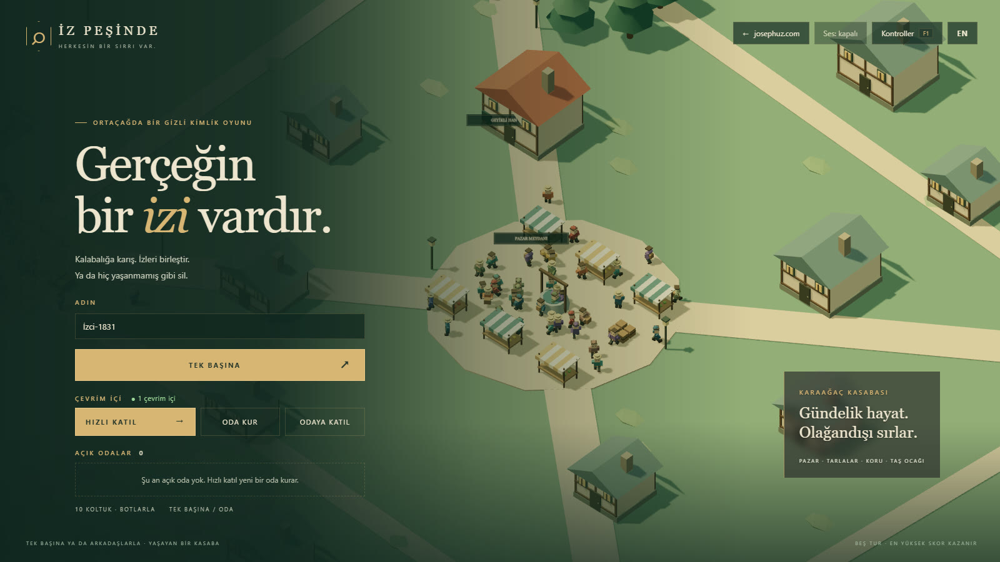
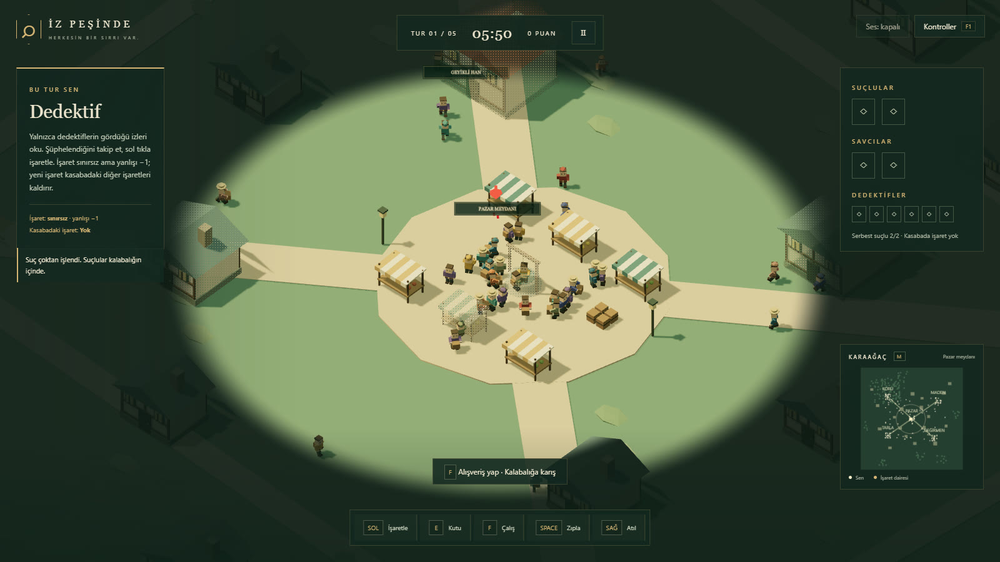
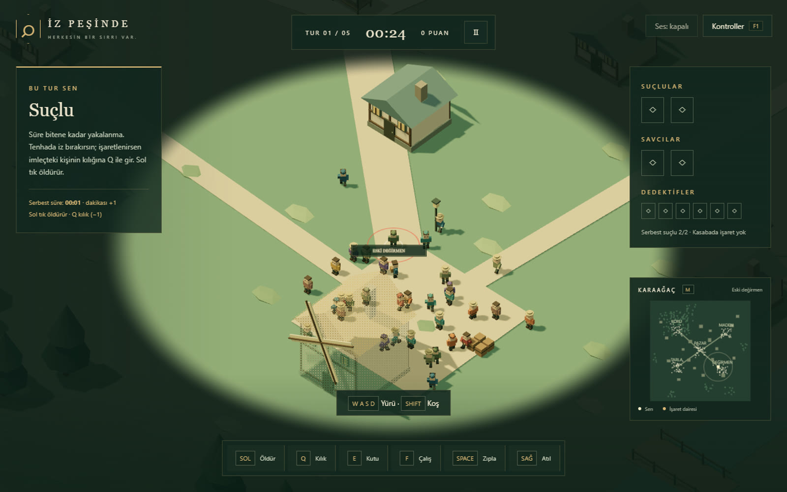

# İz Peşinde

> **EN:** An isometric medieval hidden-identity game in the browser (Three.js): the culprit hides in the crowd, the detective reads the clues, the prosecutor makes the arrest; solo against bots or in an online room.
>
> **TR:** Tarayıcıda (Three.js) izometrik ortaçağ gizli kimlik oyunu: suçlu kalabalığa karışır, dedektif izleri okur, savcı yakalar; botlara karşı tek başına ya da çevrim içi odada.

**Play / Oyna:** https://izpesinde.josephuz.com · **Source / Kaynak:** https://github.com/JosephUz/izpesinde

 

Three.js ile tarayıcıda çalışan, izometrik bir **ortaçağ gizli kimlik** oyunu: tek başına botlara karşı ya da
**çevrim içi odada** arkadaşlarla. Karaağaç kasabasında 10 yarışmacı ve 170 kasabalı dolaşır. Tek başına her tur
rolünü seçersin, odada roller her tur rastgele gelir: **suçlu** kalabalığa karışıp süre bitene
kadar yakalanmamaya, **dedektif** izleri okuyup şüpheliyi işaretlemeye, **savcı** izlerin ve işaretlerin peşinden
doğru kişiyi yakalamaya çalışır. Beş turun sonunda en yüksek kişisel skor kazanır.

Kuralların tamamı ve gerekçeleri: [DEDEKTIF_OYUNU_TASARIM.md](DEDEKTIF_OYUNU_TASARIM.md). Görsel dil ve kod düzeni
[Çayır Muhafızı](https://github.com/JosephUz/cayirmuhafizi) ile aynıdır.

## Başlatma

`Baslat.cmd` dosyasına çift tıklayın: ilk açılışta `npm install` çalışır, oyun tarayıcıda açılır.
Alternatif: bu klasörde `npm install` ve `npm start`, ardından http://127.0.0.1:5197.
Node.js gerekir; ilk kurulumdan sonra internet bağlantısı gerekmez. Port için PowerShell'de `$env:PORT=5198; npm start`.

**Docker ile (compose)**: `docker compose up -d --build`; oyun http://localhost:5197 adresinde, yalnızca bu bilgisayara
açık (`127.0.0.1`). Kaynak değişince yine `--build` yeter. **İnternete açmak** için `docker compose --profile tunnel up -d --build`:
`cloudflared` konteyneri `.env` dosyasındaki `TUNNEL_TOKEN` ile tünele bağlanır, oyunun ağ alanını paylaşır; Cloudflare
panelindeki rota `izpesinde-sunucu.josephuz.com` → `http://localhost:5197`.
Konteyner açıkken `Baslat.cmd` ikinci bir sunucu açmaz, çalışanı bulup tarayıcıyı ona açar.
Sunucu oyun dosyalarını `no-store` ile verir; `/health` yanıtı ayakta olan yapının damgasını içerir.

**Web yayını**: `npm run deploy:web` dosyaları `dist/` klasörüne toplayıp Cloudflare Worker'a
(`izpesinde.josephuz.com`, bkz. `wrangler.jsonc`) gönderir. İstemci değişikliği canlıya ancak böyle gider; sunucu
değişikliği `docker compose --profile tunnel up -d --build` ile. Statik sitedeki istemci `src/config.js → SERVER`
(`izpesinde-sunucu.josephuz.com`) adresine bağlanır; sunucuya bağlanamadıkça oda düğmeleri **YAKINDA** yazar, tek
başına oyun aynen oynanır.

## Çevrim içi oda

Akış bütün JosephUz oyunlarındaki **oda standardına** uyar (josephuz deposunda `docs/oda-standardi.md`; yazılar
oradakiyle bire bir). Ana ekranın **ÇEVRİM İÇİ** bölümünde (`● N çevrim içi`): **HIZLI KATIL →** en dolu herkese açık
lobiye oturtur, uygun oda yoksa yeni herkese açık oda kurar; **ODA KUR** odayı hemen kurar (son seçilen bot zorluğuyla,
`iz.level`; herkese açık) ve seni bekleme odasına alır; **ODAYA KATIL** altında `ODA KODU` + **KATIL** satırını açar
(Enter de katılır; kod büyük harfe çevrilir, tiresiz `KPRT4` → `KPRT-4`, kısa kodda `Oda kodunu yaz`). Durum satırı
`Oda aranıyor…` / `Oda kuruluyor…` / `Odaya bağlanıyor…` ya da hatayı (`Böyle bir oda yok` · `Oda dolu` ·
`Maç başlamış`) gösterir. Altında **AÇIK ODALAR** listesi ana ekranda durur (ayrı pencere yok): lobideki herkese açık
odalar, önce insanı çok olan, en çok 20; satırın tamamı bir düğme — kuranın adı, `Normal botlar · n/10 oyuncu`,
**LOBİDE**, **KATIL →** (doluysa **DOLU**). Sunucu listeyi odada olmayan bağlantılara değişince kendisi yollar
(~250 ms); istemci yoklamaz. Boşken: `Şu an açık oda yok. Hızlı katıl yeni bir oda kurar.` Sunucuya bağlanılamazken
üç düğme **YAKINDA** yazar ve liste gizlenir. İz Peşinde'de maç sürerken odaya katılınmaz; liste maçtaki odaları,
rolleri, skorları göstermez.

Davet linki `?oda=KOD`: açılınca sunucuya bağlanır bağlanmaz odaya kendiliğinden girilir (ad boşsa varsayılan ad).
Odadayken adres çubuğu `?oda=KOD` gösterir, odadan çıkınca silinir; sayfa yenilenirse aynı odaya dönülür
(`Odaya geri bağlanıyor…`).

**Bekleme odası**: üstte `ODA · <zorluk> botlar`, büyük kod, **Linki kopyala** (`Link kopyalandı`; pano yoksa link
yazılır) ve `AÇIK ODA · listede görünür` / `ÖZEL ODA · yalnız kodla`. 10 koltuk, **taraf yoktur**: dolu koltukta ad ve
`kuran` / `sen` / `koptu`; boş koltukta botun adı ve `Bot · boş koltuk` (üstüne gelince `Buraya otur`), boş koltuğa
tıklayan oraya geçer, boş koltukları botlar doldurur. Kuran bir oyuncuyu sürükleyip başka koltuğa bırakır ya da önce
oyuncuya sonra koltuğa tıklar (`Taşınacak koltuğa tıkla`); dolu koltuğa bırakırsa ikisi yer değiştirir. Botların
zorluğunu ve **ODA: Herkese açık / Özel**'i yalnız kuran değiştirir (özel oda listede ve Hızlı katıl'da görünmez).
Bilgi satırı `N insan · M bot · beş tur`; kuranda **MAÇI BAŞLAT ↗**, ötekilerde kapalı
`Kuranın başlatması bekleniyor`; **Odadan çık**. Esc bekleme odasını kapatmaz. **Rol seçimi yoktur**, her tur herkes
rastgele rol alır. Tur akışı sunucunun saatiyle: 6 sn giriş (kimse kıpırdamaz) → 6 dk oyun → 16 sn tur sonu (önce ~4 sn bitiş sahnesi, sonra tablo)
tablosu → sonraki tur; beşinci turdan sonra oda lobiye döner (maç sonu tablosunda **LOBİYE DÖN →**, kuran yeniden
başlatır). Esc menüsü oyunu durdurmaz; çıkış düğmesi çevrim içiyken **Odadan çık**.

- **Sunucu otoriterdir** (`server/rooms.mjs`): her oda kendi dünyasını saniyede 20 adım koşturur, 10 Hz paket yollar.
  Karakter paketi ikilidir ve herkese aynıdır (180 karakter ~1,6 KB: konum, yön, görünüş, bayraklar; rol yok).
- **Kişiye özel durum** (`src/net/visibility.js`): roller yalnızca tanıdıklar için, izler yalnızca kendi rolünün ve
  görüş alanının, ele verilen savcılar yalnızca suçlulara, özel bildirimler yalnızca sahibine gider. Konsoldan bakan
  oyuncu ekranında göremeyeceği bir şeyi paketlerde de bulamaz.
- **İstemci** (`src/net/client.js`) dünyanın kopyasını kurar; sahne, arayüz ve harita tek başına oyunun koduyla
  çizer. Başkaları 0,1 sn geriden ara değerle, kendi karakterin yerel girdiden üretilen ileri kaymayla anında yürür.
- **Kopma**: kimlik sekmeye özel bir token'dır; sayfa yenilenince ya da bağlantı kopunca aynı koltuğa dönülür (lobide koltuk 8 sn `koptu` olarak tutulur).
  Koparken karakterini bot yönetir, dönünce sana geçer. Bağlı kimse kalmayınca oda kapanır.
- `/health`: `{ oyun, rooms, online, inRoom, surum }`; `online` siteyi açık tutan sekme sayısıdır (menünün alt
  ÇEVRİM İÇİ başlığının yanında "● N çevrim içi", josephuz.com'da da görünür).

## Ekranlar

Çayır Muhafızı düzeni. **Giriş**: sağ üstte [standart üst araç çubuğu](#standart-üst-araç-çubuğu); ad (hatırlanır,
ilk girişte hazır bir adla gelir), **TEK BAŞINA ↗**, altında **ÇEVRİM İÇİ** bölümü (HIZLI KATIL → · ODA KUR · ODAYA
KATIL, durum satırı, AÇIK ODALAR listesi; bkz. [Çevrim içi oda](#çevrim-içi-oda)), bilgi satırı ve (yüksek ekranda)
01 / 02 / 03 kural kartları; menü sığmazsa kendi içinde kayar. **Hazırlık**: Tek başına önce botların zorluğunu sorar
(hatırlanır; ODA KUR ve HIZLI KATIL yeni odayı bu zorlukla kurar). **F1** her ekranda kontrolleri açar.

### Standart üst araç çubuğu

Bütün JosephUz oyunlarında aynı: ana ekranın **sağ üstünde, tek satır**, bu sırayla
`← josephuz.com` · `Ses: açık/kapalı` · `Müzik: açık/kapalı` · `Kontroller F1`. **Esc menüsü** de standart:
`DEVAM ET →` · `Kontroller F1` · `Ses: …` · `Müzik: …` (altında müzik sesi sürgüsü) · `Ana menü` (çevrim içinde
`Odadan çık`) · `josephuz.com'a dön`; alt alta, pencere düğme sütunu kadar dar. İki yerdeki aynı düğme aynı durumu
gösterir (`src/main.js` → `syncMenu`); durumlar tarayıcıda saklanır (`iz.sound`, `iz.muzik`, `iz.muzik.ses`).
Ses düğmesi yalnız efektleri, Müzik düğmesi yalnız müziği kapatır — ikisi bağımsızdır. Telefonda dört düğme simgeye
iner (`←` `🔊` `♫` `?`), sıra ve düğmeler aynı kalır. Yerleşimi `tests/standart-cubuk.mjs`, yazıları ve sırası
`tests/muzik.test.mjs` denetler.

## Müzik

Yusuf 8 Ekim 2026: oyunun müziği aşağıdaki üç parça (josephuz.com Müzik sekmesinde de bunlar). Öbür parçalar
`muzik/archive/` altında durur (bkz. `muzik/archive/NOT.txt`), yayına girmez.

Üç parça, `muzik/` altında (128 kbps mp3; beste JosephUz, örnekler VSCO 2 CE / CC0 — `muzik/LISANS.txt`):
**Pazar Meydanı** sakin (menü, hazırlık, lobi, rol seçimi, tur girişi, mola, sonuç), **Dosyalar** tur sırasında,
**Suçlu Aramızda** turun son 60 saniyesinde ya da savcının kovalamacasında (ana temayla sırayla). Sahne seçimi saf bir
işlevdir (`src/muzik.js` → `sahneSec`); çalma `<audio>` öğeleriyle, 1,8 sn çapraz geçişle olur. Düzey efektlerin
altındadır (varsayılan %35), ilk kullanıcı dokunuşundan sonra başlar, sekme gizlenince durur. Tur parçası ancak tur
başlarken iner. Otomatik tarayıcıda (`navigator.webdriver`) müzik hiç kurulmaz — `?muzik=1` açar, `?muzik=0` kapatır.
Testler: `tests/muzik.test.mjs` (tarayıcısız sahne kuralı), `tests/muzik-smoke.mjs` (gerçek tarayıcıda ölçüm).

## Otopilot (müzik videoları)

`?otopilot=1`: kesintisiz **gerçek** maç, oyuncunun karakterini bir bot oynar (dünyada insan yok). Menü, hazırlık, rol
seçimi ve tur girişi atlanır; tur bitince bitiş sahnesi ve tablo ~6 sn görünür, sıradaki tur kendiliğinden başlar.
`&rol=detective|prosecutor|criminal` her turdaki rolü sabitler, `&ileri=200` ilk turu ekrana gelmeden 200 sn ileri
sarar, `&tohum=7` maçın tohumudur. Paperclip'in müzik videosu betiği (`paperclip/ajanlar/icerik/muzik-videosu.mjs`) bu
kipi `?otopilot=1&muzik=0` ile açar ve `window.__iz`'e bakar.

## Telefon ve tablet

Çayır Muhafızı düzeni. Dokunmatik ekran algılanınca (masaüstünde `?touch`) açılır, ekran yataydır (dikeyde oyun
sırasında "Telefonu yan çevir" uyarısı). Sol yarıda **joystick** (sonuna kadar itmek koşu). **Dünyaya dokunmak hedef
seçer** (halka çıkar; görüş alanından çıkana ya da başkası seçilene kadar kalır) ama eylem yapmaz: yanlış dokunuş
−1'e mal olmasın diye eylem düğmeyle yapılır. Sağ altta büyük düğme rolün eylemi (İŞARETLE / YAKALA / ÖLDÜR, seçili
hedefe), KILIK (yalnızca suçluda), KUTU, ÇALIŞ, ZIPLA, ATIL; sağ üstte HARİTA, SKOR (basılı tut; elenince izlenen kişiyi
değiştirir) ve ☰ menü. **İki parmakla** yaklaştırılır / uzaklaştırılır (kıpırdamamış joystick parmağı da ikinci
parmakla birlikte yakınlaştırmaya döner; yürürken başlamaz). HUD sıkışık düzene geçer. Oyuna girerken tam ekran ve yatay kilit istenir. Telefonda kenar
yumuşatma kapalı, piksel oranı 1, gölge haritası küçüktür. Kök, tarayıcı çubuklarının bıraktığı görünür alana kilitlenir
(`src/gorunur-alan.js`, Çayır Muhafızı ile aynı dosya). Kod: `src/touch.js`, `src/input.js`. Test: `tests/touch-smoke.mjs`.

## Bir tur

1. **Rol seçimi** (tek başına): üç karttan birini seç. Botlar kalan rolleri paylaşır; her tur 2 suçlu, 6 dedektif,
   2 savcı vardır. Çevrim içi odada rol rastgele gelir.
2. Suç zaten işlenmiştir; tur 6 dakikalık geri sayımla ilerler. Yarışmacılar haritanın farklı yerlerinde başlar.
3. Herkes yalnızca çevresindeki daireyi görür; dışı kararır. Küçük haritada ise herkes aynı renkte nokta olarak
   görünür: kim olduğu belli değildir ama tenhaya sapan biri fark edilir. Biri (oyuncu, bot ya da kasabalı) bir evin, tezgâhın ya da
   ağacın arkasına geçince o nesne saydamlaşır.
4. Suçlular arkalarında 2 saniyelik izler bırakır: dedektif izini yalnızca dedektifler, savcı izini yalnızca savcılar
   görür; ikisi de suçlunun birkaç saniye önce tam bastığı noktaya, yürüyüş yönüne bakan bir çift ayak izi olarak düşer.
   Düşen izin üstünde zıplayan bir ok belirir. İz aralığı 5 → 4 → 3 → 2 sn, gecikme 5 → 4 → 3 → 2 → 1 sn kısalır.
5. Dedektif gördüğü herhangi birini (görüş alanındaki herkes, yaklaşmadan) sol tıkla işaretler: sınırsız ama yanlışı −1, ve kasabada tek işaret olur (yeni işaret kendi ve
   diğer dedektiflerin işaretlerini kaldırır); işareti ve yaklaşık bölgesini herkes görür. Savcı doğru kişiyi
   sol tıkla yakalar (menzil ayağının altındaki altın halka): yakalama sınırsız ama yanlışı −1 ve her denemede savcının kimliği 10 sn suçlulara açılır.
   İşaretlenen suçlunun ekran kenarı kızarır; imleçteki birinin kılığına Q ile girerse (−1) işaret kalkar. Suçlu
   imleçteki kişiyi sol tıkla öldürür (sınırsız; menzil ayağının altındaki kırmızı halka). İmleçteki kişi halkanın
   içindeyse halka parlar.
   Yakalanır ya da öldürülürsen kamera karakterine yaklaşır: kafes iner ya da yere yığılırsın, altta bir kart açılır;
   sonra takım arkadaşını izlersin. Görüş alanındaki herkesin yakalanması / öldürülmesi de animasyonludur. Tur bir anda
   bitmez: tablo açılmadan önce herkes ~4 sn bitiş sahnesini izler (kamera son olaya yaklaşır, büyük başlık).
   Sağ üstteki panel: suçlu (yakalanan ✓), savcı ve küçük dedektif kutucukları (ölen ✗; yalnızca sayı, kimlik değil).
6. Tur biter: iki suçlu yakalanırsa kanun kazanır. Süre dolarsa ya da iki savcı da ölürse suçlular kazanır.

## Tuşlar

| Girdi | Eylem |
| --- | --- |
| WASD | Kamera yönüne göre yürü |
| Shift | Koş |
| Space, havadayken tekrar | Zıpla, çift zıpla |
| Sağ tık | Atıl |
| Sol tık | İmlecin altındaki kişi: dedektif işaretler, savcı yakalar, suçlu öldürür |
| E | Yakındaki kutuyu al / bırak |
| F | İş noktasında çalış |
| Q | Suçlu: imleçteki kişinin kılığına gir (−1) |
| M | Küçük haritayı büyüt / küçült |
| Fare tekerleği | Yaklaştır / uzaklaştır (tercih saklanır) |
| Tab | Basılı: skor; elenince: izlenen takım arkadaşını değiştir |
| Esc | Duraklat / devam (çevrim içi odada oyun durmaz) |

Efekt sesi sağ üstteki `Ses` düğmesinden açılır (başlangıçta kapalı; seçim saklanır), müzik yanındaki `Müzik`
düğmesinden (başlangıçta açık). İkisi de Esc menüsünde aynı durumu gösterir.

## Puanlar

| Olay | Puan |
| --- | --- |
| Kanun kazanır | Her dedektif ve savcı +1 |
| Suçlular kazanır | Serbest kalan her suçlu +5 |
| Serbest geçen her tam dakika | Suçluya +1, kazansa da kaybetse de |
| Doğru yakalama | Savcıya +1, o kişide aktif işareti olan dedektife +1 |
| Yanlış yakalama / suçlu olmayanı işaretleme | Her biri −1 (ikisi de sınırsız; yanlış işaret tur sonunda yazılır) |
| Kılık değiştirme | −1 |
| NPC / dedektif / savcı öldürme | −1 / +1 / +2 |

## Testler

`npm test`: önce başsız kural testleri (`tests/rules-smoke.mjs`: rol dağıtımı ve seçimi, iz takvimi, izin tam basılan
noktaya düşmesi ve iki iz türü, sınırsız işaret ve kasabada tek işaret, yakalama, kılık, cinayet ve iki savcının ölümü, puanlar, kutu,
zıplama/iniş, izleyici, çok insanlı dünya, çevrim içi paketin gizli bilgi taşımaması, beş turluk otomatik maç) ve
müziğin sahne kuralı + standart çubuğun yazıları (`tests/muzik.test.mjs`, tarayıcısız). Sonra
sunucuyu boş bir portta açar (testte tur 25 sn, `IZ_TUR_SN`): çevrim içi duman testi (`tests/online-smoke.mjs`, iki
WebSocket istemcisi: lobi, koltuk, gizli roller, giriş evresi, hareket, kopup geri dönme, ayrılma) ve açık odalar testi (`tests/acik-odalar.mjs`: liste istemeden gelir, özel oda, Hızlı katıl, dolu / başlamış oda (`Maç başlamış`), tiresiz kod, kuranın taşıması / yer değiştirme,
listede gizli bilgi yok), başsız Chromium ile
tek başına duman testi (`tests/browser-smoke.mjs`: menü, rol seçimi, hareket, görüş sisi, duraklatma, gerçek sol tıkla
işaret / yakalama / kılık, kenar uyarısı, kutu, sabit nesne saydamlığı, iz oku, skor tablosu, küçük ekran, beş tur
geçişi), müzik ölçümü (`tests/muzik-smoke.mjs`: hangi sahnede hangi parça, düğme durduruyor mu, yenilemede korunuyor
mu, efekt sesinden bağımsız mı — `<audio>` öğelerinin `paused` / `currentTime` değerlerinden), standart üst çubuğun
yerleşimi (`tests/standart-cubuk.mjs`: masaüstü + üç telefon ölçüsü, Esc menüsü) ve iki tarayıcıyla çevrim içi test
(`tests/online-browser.mjs`: ODA KUR hemen, linkle kendiliğinden katılma, `?oda` adreste, koltuk, kuranın tıkla-taşı ve sürükle-bırak ile yer değiştirmesi, yenileyince aynı koltuk, başlat, tur
girişi, hareket ve öbür ekranda aynı yer, tur sonu, ikinci tur, menü, çıkış) ile açık odalar tarayıcı testi
(`tests/acik-odalar-browser.mjs`: ana ekrandaki liste, satırdan KATIL, özel oda, kodla katıl, Hızlı katıl, 390 px telefon). `online-smoke.mjs` canlı sunucuya da
koşturulabilir: `GAME_URL=https://izpesinde-sunucu.josephuz.com node tests/online-smoke.mjs`. Playwright bu depoya kurulmaz; komşu depolardaki kurulum
bulunur (bkz. `scripts/test.mjs`). Ekran görüntüleri `artifacts/` altına yazılır.

## Dosyalar

Simülasyon ile görünüm ayrıdır: `src/world.js` ve ona bağlı modüller DOM ve çizim olmadan (Node'da da) koşar; tek
yetkili adımda bütün kurallar işler. İstemci modülleri dünyayı yalnızca okur, oyuncu eylemlerini girdi olarak verir.

| Dosya | Sorumluluk |
| --- | --- |
| `index.html`, `style.css` | Tam ekran düzen: sahne, HUD, rol kartı, harita, eylem çubuğu, ekranlar |
| `game.js` | Giriş; `src/main.js`'i yükler (import map: `three` → `/vendor/three.module.js`) |
| `src/config.js` | Tüm ayar sayıları: tur, hız, görüş, iz takvimi, menziller, puanlar, zorluk, kamera, saydamlık |
| `src/world.js` | **Simülasyon**: dünya (bir ya da çok insan), tur kurulumu (seçilen rol ya da herkese rastgele), sabit adım, sol tık eylemi, izleyici |
| `src/marks.js` | Dedektif işareti (kasabada tek işaret), savcı yakalaması ve ele verilmesi, haritadaki daire, iki savcının ölümü bitişi |
| `src/criminal.js` | Suçlu eylemleri: kılık değiştirme (Q), öldürme (sol tık) |
| `src/traces.js` | İz kaydı, zaman takvimine göre iki tür iz (tam basılan nokta ve yön), bot dedektif / savcıların iz algısı |
| `src/crowd.js` | Hareket, zıplama, atılma, kutu taşıma, çalışma, kasabalı rutinleri ve rota izleme |
| `src/ai.js` | Bot kararları: dedektif (şüphe, takip, işaret), savcı (daire, iz, yakalama), suçlu (kalabalık, kılık, cinayet) |
| `src/score.js` | Tur sonu ve puan toplama |
| `src/roster.js` | Kadro yardımcıları: yarışmacılar, oyunda mı, görüş, en yakın, olay günlüğü |
| `src/physics.js` | Çarpışma, görüş hattı, güvenli iniş, ızgara + ikili yığınla A* yol bulma |
| `src/environment.js` | Kasaba verisi (bölgeler, binalar, ağaçlar, iş noktaları, kutular) ve 3B kurulumu |
| `src/rng.js` | Tohumlu rastgelelik |
| `src/main.js` | **İstemci**: sahne, kamera, ışık, oyun akışı (tek başına: menü → rol seçimi → tur → sonuç; çevrim içi: oda → lobi → turlar), çizim döngüsü, test kancası |
| `src/net/` | Çevrim içi: ortak sözlük (`protocol.js`), ikili karakter paketi (`snapshot.js`), kişiye özel durum (`visibility.js`), istemci: bağlantı, kopya dünya, ara değer, ileri kayma, girdi (`client.js`) |
| `src/platform.js` | Sunucu adresi (statik sitede `SERVER`, yerelde aynı adres) |
| `server/rooms.mjs` | Odalar: lobi ve koltuklar, otoriter dünya, tur akışı, kopma / geri dönme, çevrim içi sayısı |
| `src/screens.js` | Rol seçimi, çevrim içi lobi, tur girişi, kontroller, standart Esc menüsü, tur / maç sonu, skor tablosu |
| `src/muzik.js` | Oyun içi müzik: sahne seçimi (saf), çapraz geçiş, gerektiğinde yükleme, açma/kapama ve ses düzeyi |
| `src/ui.js` | HUD, olay günlüğü, bağlam ipucu, eylem çubuğu, dünya etiketleri, savcı okları, kenar uyarısı, ses |
| `src/input.js` | Klavye / fare, imleçle hedef seçme; dokunmatikte joystick, dokunarak hedef, düğmeler |
| `src/touch.js`, `src/gorunur-alan.js` | Dokunmatik katman (joystick, düğmeler, tam ekran) ve telefonda görünür alan kilidi |
| `src/minimap.js` | Üstten 2B harita: kasaba, herkesin konumu (kimliksiz nokta), işaret daireleri, görüş çemberi |
| `src/characters.js` | Kutu karakterler, instancing ile toplu çizim, ayak halkaları, imleç hedefi |
| `src/fog.js` | Görüş sisi (three'nin sis parçaları karakter çevresi uzaklığına göre yeniden yazılır) |
| `src/view/` | Mesh takımı ve birleştirme (`meshes.js`), ayak izleri, iz oku ve olay efektleri (`effects.js`), kutular (`itemview.js`), arkasına biri geçen sabit nesnenin saydamlığı (`seethrough.js`) |
| `scripts/test.mjs`, `scripts/build-web.mjs` | Test koşturucusu; web yayını için `dist/` |
| `Dockerfile`, `compose.yaml`, `.dockerignore` | Konteyner: tek imaj, sağlık denetimi, yalnızca bu bilgisayara açık port; `tunnel` profili ile cloudflared |
| `server.mjs` | Tek port: statik dosyalar (three /vendor/ altından, `no-store`), WebSocket odaları (Origin denetimi: aynı adres, *.josephuz.com, localhost), `/health` |

## Sınırlar

Hesap, kayıtlı maç, yabancılarla eşleştirme ve dokunmatik kontrol yoktur. Görüş alanı çiziminde binalar görüşü kesmez (botların algısında
görüş hattı vardır). Bot dengesi ilk ayardadır; otomatik maçlarda kanun 20 turun 11’ini kazanıyor; suçluların galibiyetlerinin çoğu iki savcıyı öldürerek geliyor. Oynanışa
göre `LEVELS` ve `CFG.trace` değerleri ayarlanmalıdır.

## Lisans / License

- **Kod:** [MIT](LICENSE), Copyright (c) 2026 JosephUz. Kodu kullanabilir, değiştirebilir, dağıtabilirsin.
- **MIT dışında, tüm hakları saklıdır:** "İz Peşinde" ve "JosephUz" adları; `muzik/` altındaki müzikler. Ayrıntı: [TRADEMARKS.md](TRADEMARKS.md). Müzik için `muzik/LISANS.txt`.
- **Fork'lar** başka bir ad ve logo kullanmalı, resmî sürüm olduğunu ima etmemeli.
- **Üçüncü taraf:** [three.js](https://github.com/mrdoob/three.js) ve [ws](https://github.com/websockets/ws) npm bağımlılığıdır (ikisi de MIT), depoda değil, kendi lisanslarıyla gelir. Müziklerdeki enstrüman örnekleri VSCO 2 Community Edition (CC0).

> **In English:** The code is licensed under [MIT](LICENSE). The name "İz Peşinde", the name "JosephUz", the music in `muzik/` are **not** covered by MIT and are all rights reserved; see [TRADEMARKS.md](TRADEMARKS.md). Forks must use a different name and logo.

## Katkı / Contributing

Hata bildirimi, öneri ve pull request'e açığız. Büyük bir değişiklikten önce bir [issue](https://github.com/JosephUz/izpesinde/issues) açıp konuşalım; oyunun dengesi ve yönü JosephUz'da. Kod ve oyun Türkçe: değişken, işlev ve mesaj adları Türkçe, çevresindeki kodun düzenine uy; `npm test` geçmeli. Gönderdiğin katkı bu deponun MIT lisansıyla yayımlanır. Müzik, ses ya da görsel eklemeden önce issue'da sor. Güvenlik açıklarını issue yerine [SECURITY.md](SECURITY.md)'deki yoldan bildir.

> **In English:** Issues and pull requests are welcome; please open an issue before large changes. Contributions are accepted under the MIT license of this repository. Report security issues privately as described in [SECURITY.md](SECURITY.md).
